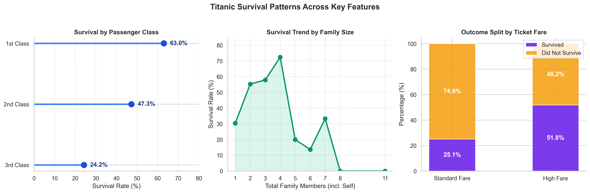

# Titanic Survival Analysis: Data Wrangling & EDA

An exploratory data analysis (EDA) project examining the Titanic passenger dataset (`n = 891`) to clean raw records, engineer meaningful behavioral features, and identify the key socio-economic factors behind passenger survival.

## Key Findings
* **Overall Survival:** Only **38.38%** of passengers survived.
* **Passenger Class (`Pclass`):** 1st-class passengers had a **62.96%** survival rate, compared to **47.28%** in 2nd class and **24.24%** in 3rd class.
* **Ticket Fare (`HighFare`):** Passengers paying above the median fare were more than twice as likely to survive (**51.80%** vs. **25.06%**).
* **Family Travel (`IsAlone`):** Passengers traveling with family had a **50.56%** survival rate, whereas solo travelers had a **30.35%** rate—with small families (2–4 members) showing the highest survival trend.

> **Analytical Note (Association ≠ Causation):** Higher fares and 1st-class tickets did not directly cause survival; rather, they acted as proxies for cabin proximity to the upper deck and priority access to lifeboats during evacuation.

## Methodology & Workflow
1. **Data Auditing & Cleaning:**
   * Dropped the `Cabin` column due to excessive missingness (>77%).
   * Imputed missing `Age` values (19.87%) using the **median** to prevent skewing from outliers, and filled missing `Embarked` records (0.22%) with the **mode**.
   * Applied programmatic integrity checks (`assert` statements) to verify zero missing values, unique passenger IDs, and valid value ranges.
2. **Feature Engineering:**
   * `FamilySize`: Total family members aboard (`SibSp + Parch + 1`).
   * `IsAlone`: Binary indicator distinguishing solo travelers from family groups.
   * `HighFare`: Flag identifying tickets priced above the dataset median.
3. **Custom Data Visualization:**
   * Built a multi-chart visual summary using **Matplotlib** (Lollipop chart, Line+Area trend plot, and 100% Stacked Bar chart) to highlight outcome disparities across features.

## Repository Files
* `Titanic_Survival_Analysis.ipynb` — Complete Jupyter Notebook with code, validation checks, and findings.
* `titanic_cleaned.csv` — Processed and validated dataset ready for modeling.
* `titanic_custom_charts.png` — High-resolution visual summary of survival patterns.

## Tools Used
* Python 3
* Pandas & NumPy
* Matplotlib
